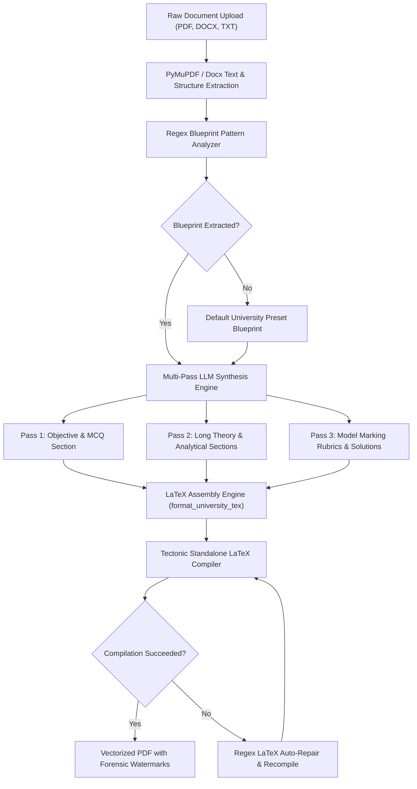
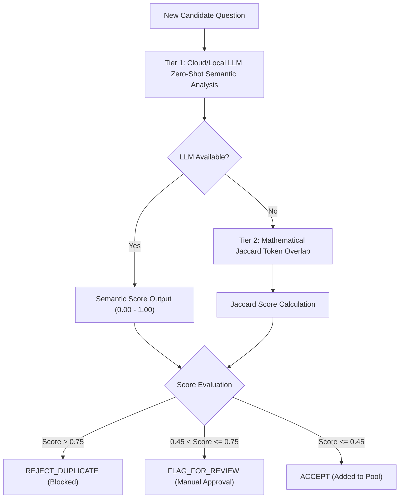

# ZeroLeak: Comprehensive AI & Machine Learning Specification

> **Audit Date:** October 2026 | **Version:** 2.4.0 Production Build  
> **Status:** Verified against executable code in `security_monitor.py`, `server/ai.ts`, `server/aiProviders.ts`, `server/aiExamGenerator.py`, and `server/pdf_extractor.py`.

---

## 1. Executive Summary & Verification Classification

In strict compliance with academic and professional audit standards, this document distinguishes between models accessed via inference, pretrained models loaded locally, and algorithmic heuristics.

| Subsystem | Exact Model / Algorithm | Category | Model Type | Training Status | Runtime Environment | Verified File |
|---|---|---|---|---|---|---|
| **Computer Vision Proctoring** | Ultralytics YOLOv8 Nano (`yolov8n.pt`, `yolov8s.pt`) | Deep Learning (CNN) | Pretrained (COCO Dataset) | Pretrained (Zero local retraining) | Local CPU / GPU via OpenCV & PyTorch | [`security_monitor.py`](file:///d:/0leakexam-main/security_monitor.py) |
| **Exam Paper Synthesis** | LLaMA 3.2 / Qwen 2.5 / Gemini 2.5 Flash | Generative AI (LLMs) | Pretrained Foundation Models | Prompt-engineered inference | Local Ollama daemon OR Cloud APIs (Groq, NVIDIA NIM, Gemini) | [`server/aiProviders.ts`](file:///d:/0leakexam-main/server/aiProviders.ts)<br>[`server/aiExamGenerator.py`](file:///d:/0leakexam-main/server/aiExamGenerator.py) |
| **Question Deduplication** | Zero-Shot Semantic Evaluation + Jaccard Set Overlap | NLP & Lexical Heuristic | Hybrid (LLM + Math) | Pretrained LLM + Deterministic Math | Cloud / Local failover | [`server/ai.ts`](file:///d:/0leakexam-main/server/ai.ts) (L179-L255) |
| **Bilingual Translation** | Prompt-guided NLLB / LLaMA 3.3 / Qwen | NLP (Machine Translation) | Pretrained LLM | Pretrained Foundation Models | Local Ollama / Groq API | [`server/ai.ts`](file:///d:/0leakexam-main/server/ai.ts) (L533-L650) |
| **Document OCR & Slicing** | PyMuPDF Text Layer + RapidOCR / Tesseract.js | Computer Vision & OCR | Classical CV + Deep OCR | Pretrained OCR weights (`eng.traineddata`) | Local Python subprocess | [`server/pdf_extractor.py`](file:///d:/0leakexam-main/server/pdf_extractor.py) |
| **Layout & Anomaly Scoring** | Rule-Based Cumulative Risk Heuristics | Anomaly Detection | Deterministic State Evaluator | Mathematical heuristics (No Isolation Forest) | Node.js backend runtime | [`server/repositories/AuditRepository.ts`](file:///d:/0leakexam-main/server/repositories/AuditRepository.ts) |

> [!IMPORTANT]
> **Audit Finding on Model Training:**  
> ZeroLeak does **NOT** train custom deep learning weights from scratch. All deep learning and generative capabilities use **pretrained foundation weights** (COCO-trained YOLOv8, open-weight GGUF models in Ollama, or API-accessible foundation models). The engineering contribution lies in **computer vision pipeline orchestration, multi-modal layout analysis, prompt synthesis, LaTeX compilation, and failover routing**.

---

## 2. Deep Dive: Computer Vision & Real-Time Proctoring (`security_monitor.py`)

### 2.1 Problem Solved
During remote question drafting, linguistic translation, or candidate examinations, unauthorized personnel or mobile recording devices may capture confidential examination content off the screen.

### 2.2 Model Architecture & Weights
- **Network Architecture:** Ultralytics YOLOv8 Nano (`yolov8n.pt`, 6.5 MB, ~3.2M parameters).
- **Backbone:** Modified CSPDarknet53 with cross-stage partial connections to extract multi-scale spatial features.
- **Neck:** PANet (Path Aggregation Network) combining bottom-up and top-down feature pyramids.
- **Head:** Anchor-free decoupled head separating classification and bounding-box regression loss.
- **Target Classes Detected:**
  - Class `0`: `person` (Confidence threshold $\tau_{\text{person}} \ge 0.50$).
  - Class `67`: `cell phone` (Confidence threshold $\tau_{\text{phone}} \ge 0.45$).

### 2.3 Mathematical Formula & Temporal Frame Debouncing
To prevent false alarms from transient shadows or quick hand gestures, the engine implements a **temporal confirmation debouncing algorithm**:

$$\text{Detection Condition} = \begin{cases} 
\text{VIOLATION\_LOCKED}, & \text{if } \sum_{t=0}^{N-1} \mathbb{I}(\text{Conf}_t \ge \tau_{\text{phone}}) = N \quad (N = 3) \\
\text{CANDIDATE\_ABSENT}, & \text{if } \text{Count}(\text{person}) = 0 \text{ for } T > 5 \text{ seconds} \\
\text{MULTIPLE\_PERSONS}, & \text{if } \text{Count}(\text{person}) \ge 2 \text{ on frame } t_0
\end{cases}$$

Where $\mathbb{I}(\cdot)$ is the indicator function and $N = 3$ consecutive frames are required before a cell phone violation event is emitted over WebSocket to the security ledger.

### 2.4 Input & Output Pipeline
1. **Input:** Decoded BGR video frames from OpenCV `cv2.VideoCapture` or WebSocket base64 byte streams (`/ws/security-feed`).
2. **Preprocessing:** Frames resized to $640 \times 640$, pixel intensities normalized to $[0.0, 1.0]$.
3. **Inference:** Forward pass through PyTorch runtime (`yolo.predict(frame, conf=0.40)`).
4. **Post-Processing:** Non-Maximum Suppression (NMS) with Intersection-over-Union threshold ($\text{IoU} \ge 0.45$) eliminates duplicate bounding boxes.
5. **Output:** Real-time annotated frame with bounding boxes and an ISO-8601 JSON telemetry payload:
   ```json
   {
     "event_type": "PROCTOR_VIOLATION_CELL_PHONE",
     "timestamp": "2026-10-25T09:15:32.412Z",
     "confidence": 0.892,
     "box": [142, 85, 310, 420],
     "penalty_score": 30
   }
   ```

---

## 3. Deep Dive: Multi-Pass University Exam Synthesis (`server/aiExamGenerator.py`)



### 3.1 Synthesis Pipeline
1. **Blueprint Pattern Extraction:** Scans past papers to extract section headers (`SECTION — I`, `SECTION — II`), question counts, internal choices (*"Attempt Any Four"*), subparts `(a, b, c)`, and marks brackets `[14 Marks]`.
2. **Multi-Pass Generation:**
   - **Pass 1 (MCQ & Objectives):** Generates 14 questions with 4 distinct options `(a, b, c, d)` and clear correct keys.
   - **Pass 2 (Descriptive & Engineering Problems):** Generates numerical problems with realistic boundary conditions and derivations.
   - **Pass 3 (Marking Scheme):** Generates step-by-step examiner solution keys with mark breakdown per sub-step.
3. **LaTeX Formatting & Tectonic Compilation:** Formats generated content using standard LaTeX macros (`tabular*`, `geometry`, `amsmath`) and compiles directly to PDF via `bin/tectonic.exe` in ~0.75 seconds.

---

## 4. Deep Dive: Question Deduplication & Semantic Plagiarism Detection (`server/ai.ts`)

### 4.1 Two-Tiered Deduplication Algorithm
To balance deep semantic comprehension with offline operational resilience, ZeroLeak uses a two-tier similarity architecture:



### 4.2 Tier 2 Mathematical Heuristic (Jaccard Lexical Overlap)
When external AI APIs are unreachable, the system executes an automated fallback using the **Jaccard Word-Set Similarity Coefficient**:

$$J(Q_{\text{candidate}}, Q_{\text{pool}}) = \frac{|W_{\text{candidate}} \cap W_{\text{pool}}|}{|W_{\text{candidate}} \cup W_{\text{pool}}|}$$

Where:
- $W$ is the set of normalized alphanumeric words of length $> 3$ characters (stop words and punctuation stripped).
- If $J \ge 0.75$, the question is flagged as an exact or near-exact duplicate and blocked.

