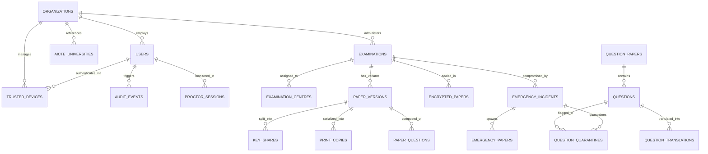

# ZeroLeak: Database Schema, Entity Relationships & API Reference

> **Audit Date:** October 2026 | **Version:** 2.4.0 Production Build  
> **Status:** Verified against `database/schema.sql`, `server/models/`, `server.ts`, and `server/competitiveExam.ts`.

---

## 1. Database Architecture & Hybrid Multi-Model Design

ZeroLeak implements an enterprise **hybrid dual-engine architecture** designed for high availability and offline resilience:

1. **Primary Operational Engine (Local Enclave):**
   - **Engine:** SQLite 3 powered by `sql.js` (WebAssembly build).
   - **File:** `zeroleak_data.sqlite` located in the root repository directory (~245 MB with seeded test banks).
   - **Characteristics:** In-memory execution speed for sub-millisecond query evaluation, with automatic disk synchronization on every write mutation (`saveDb()`). Zero external dependencies; operates fully air-gapped.
2. **Enterprise Relational Engine (Clustered Deployments):**
   - **Engine:** PostgreSQL 14+ via node-postgres (`pg` Pool).
   - **Schema Definition:** [`database/schema.sql`](file:///d:/0leakexam-main/database/schema.sql).
   - **Connection Pool:** Configured in [`server/db.ts`](file:///d:/0leakexam-main/server/db.ts) (max 20 connections, 30s idle timeout).
3. **Audit & Document Engine:**
   - **Engine:** MongoDB via Mongoose (`mongoose` 9.11.1).
   - **Models:** Defined under [`server/models/`](file:///d:/0leakexam-main/server/models/) for flexible document representations of unstructured proctoring logs and camera telemetry.

---

## 2. Entity-Relationship (ER) Diagram

---

## 3. Core Database Tables & Field Definitions

### 3.1 Users & Authentication (`users`, `trusted_devices`)
- **`users`**:
  - `id` (TEXT, PK): Unique user identifier (`usr-owner-01`, `usr-operator-01`).
  - `org_id` (TEXT, FK): References `organizations.id`.
  - `username` (TEXT, UNIQUE): Login username.
  - `email` (TEXT, UNIQUE): Registered official email address.
  - `password_hash` (TEXT): Salted bcrypt hash (`bcryptjs`, 10 salt rounds).
  - `full_name` (TEXT): Legal identity of the personnel.
  - `role` (TEXT): One of 5 active roles (`ORG_OWNER`, `EXAM_MANAGER`, `TRANSLATOR`, `CENTRE_OPERATOR`, `AUDITOR`).
  - `status` (TEXT): `ACTIVE`, `INACTIVE`, `SUSPENDED`.
  - `authorization_status` (TEXT): `AUTHORIZED`, `REVOKED`, `PENDING_VERIFICATION`.
  - `centre_id` (TEXT): Bound centre code (`CTR-101`, `CTR-MUM-01`) for centre operators.

- **`trusted_devices`**:
  - `id` (TEXT, PK): UUIDv4 device identifier.
  - `user_id` (TEXT, FK): Bound user identifier.
  - `device_uuid` (TEXT): Persistent hardware fingerprint generated on client.
  - `public_key` (TEXT): PEM-encoded ECDSA / RSA device public key.
  - `device_name` (TEXT): Registered workstation label.
  - `status` (TEXT): `PENDING`, `APPROVED`, `REVOKED`, `DISABLED`.
  - `registered_at`, `last_seen_at` (TEXT): ISO-8601 audit timestamps.

### 3.2 Examinations & Cryptographic Enclaves (`examinations`, `encrypted_papers`, `paper_versions`)
- **`examinations`**:
  - `id` (TEXT, PK): Unique exam code (`EXAM-BTN04605-OS`).
  - `name` (TEXT): Official examination title.
  - `subject`, `subject_code` (TEXT): Academic syllabus identifiers.
  - `exam_date` (TEXT): Scheduled date of examination (`YYYY-MM-DD`).
  - `exam_time`, `unlock_time` (TEXT): Precise time strings (`10:00 AM`, `09:30 AM`).
  - `status` (TEXT): `DRAFT`, `SEALED`, `READY_FOR_PRINT`, `RELEASED`, `EMERGENCY_LOCKED`.
  - `is_released` (INTEGER): `0` for pre-unlock; `1` for active window.

- **`encrypted_papers`**:
  - `id` (TEXT, PK): Cryptographic container ID.
  - `exam_id` (TEXT, FK): Bound examination.
  - `ciphertext` (TEXT): Base64-encoded AES-256-GCM encrypted paper payload.
  - `iv` (TEXT): Hex-encoded 96-bit initialization vector.
  - `auth_tag` (TEXT): Hex-encoded 128-bit Galois authentication tag.
  - `encrypted_key_rsa` (TEXT): Base64 RSA-2048 OAEP wrapped Data Encryption Key.
  - `checksum_sha256` (TEXT): SHA-256 hash of plaintext paper for tamper verification.

- **`key_shares`**:
  - `id` (TEXT, PK): Key share identifier.
  - `paper_id` (TEXT, FK): Bound paper version.
  - `share_index` (INTEGER): Polynomial evaluation point ($x \in \{1, 2, 3\}$).
  - `custodian_role` (TEXT): Assigned role (`ORG_OWNER`, `EXAM_MANAGER`, `AUDITOR`).
  - `share_hex` (TEXT): Encrypted 32-byte polynomial share representation.
  - `status` (TEXT): `PENDING_APPROVAL`, `SUBMITTED`, `EXPIRED`.

### 3.3 Printing, Quotas & Physical Tracking (`print_copies`, `print_anywhere_jobs`)
- **`print_copies`**:
  - `id` (TEXT, PK): Serialized copy barcode/tracking ID (`CPY-CTR101-00042`).
  - `exam_id`, `paper_version_id` (TEXT, FK): Reference identifiers.
  - `centre_id` (TEXT): Centre where printing was executed.
  - `operator_id` (TEXT): Identity of the Printing Operator who initiated the print.
  - `copy_number` (INTEGER): Strictly sequential serial number for that centre.
  - `watermark_hash` (TEXT): Cryptographic hash embedded in the visual watermark.
  - `printed_at` (TEXT): Exact timestamp of physical page generation.

---

## 4. Comprehensive API Endpoint Catalog

The repository exposes 288 total verified endpoints. Below is a structured reference of the primary operational routes across all subsystems.

### 4.1 Authentication & Device Verification
| Method | Route Path | Access Role | Description | Source File |
|---|---|---|---|---|
| `POST` | `/api/auth/login` | Public | Step 1 authentication; returns JWT or triggers device challenge | [`server.ts`](file:///d:/0leakexam-main/server.ts) (L1760) |
| `POST` | `/api/auth/device/register` | All Roles | Submits device public key and attestation signature | [`server.ts`](file:///d:/0leakexam-main/server.ts) (L1803) |
| `POST` | `/api/auth/device/verify` | All Roles | Verifies cryptographic signature against 32-byte challenge | [`server.ts`](file:///d:/0leakexam-main/server.ts) (L1840) |
| `GET` | `/api/devices` | `ORG_OWNER`, `AUDITOR` | Lists all pending and registered hardware devices | [`server.ts`](file:///d:/0leakexam-main/server.ts) (L2010) |
| `POST` | `/api/devices/:id/approve` | `ORG_OWNER` | Approves a trusted terminal workstation | [`server.ts`](file:///d:/0leakexam-main/server.ts) (L2085) |

### 4.2 University AI Exam Generator
| Method | Route Path | Access Role | Description | Source File |
|---|---|---|---|---|
| `POST` | `/api/university/ai-generator/upload` | `EXAM_MANAGER`, `ORG_OWNER` | Uploads syllabus/past papers & triggers Python generator | [`server/aiExamBridge.ts`](file:///d:/0leakexam-main/server/aiExamBridge.ts) |
| `GET` | `/api/university/ai-generator/status/:job` | `EXAM_MANAGER`, `ORG_OWNER` | Polls real-time progress steps and Tectonic compilation status | [`server/aiExamBridge.ts`](file:///d:/0leakexam-main/server/aiExamBridge.ts) |
| `GET` | `/api/university/ai-generator/download/:job/:which`| Internal / Enclave | Streams generated `questions.pdf` or raw `.tex` source | [`server/aiExamBridge.ts`](file:///d:/0leakexam-main/server/aiExamBridge.ts) |
| `POST` | `/api/university/ai-generator/send-to-printer` | `EXAM_MANAGER`, `ORG_OWNER` | Dispatches paper directly to selected Centre Operator login | [`server/aiExamBridge.ts`](file:///d:/0leakexam-main/server/aiExamBridge.ts) |
| `GET` | `/api/university/printing-operators` | `EXAM_MANAGER`, `ORG_OWNER` | Retrieves all registered certified Centre Operators for dropdown | [`server.ts`](file:///d:/0leakexam-main/server.ts) (L17284) |

### 4.3 Examination Delivery & Centre Operator Enclave
| Method | Route Path | Access Role | Description | Source File |
|---|---|---|---|---|
| `GET` | `/api/delivery/released-exams` | `CENTRE_OPERATOR`, `AUDITOR` | Retrieves released examinations gated by server time-lock | [`server.ts`](file:///d:/0leakexam-main/server.ts) (L10053) |
| `POST` | `/api/delivery/open-viewer` | `CENTRE_OPERATOR`, `EXAM_MANAGER` | Decrypts paper and authenticates secure viewing session | [`server.ts`](file:///d:/0leakexam-main/server.ts) (L11275) |
| `POST` | `/api/delivery/authorize-print-copy` | `CENTRE_OPERATOR` | Increments sequential copy quota and authorizes print job | [`server.ts`](file:///d:/0leakexam-main/server.ts) (L11360) |
| `POST` | `/api/print-relay/open` | `CENTRE_OPERATOR` | Opens Wi-Fi print relay & starts UDP 45412 LAN beacon | [`server/printStation.ts`](file:///d:/0leakexam-main/server/printStation.ts) |

### 4.4 Cryptographic Threshold Keys & Emergency Leak Management
| Method | Route Path | Access Role | Description | Source File |
|---|---|---|---|---|
| `POST` | `/api/papers/threshold/request-unlock`| `EXAM_MANAGER` | Initiates Shamir 2-of-3 threshold unlock request | [`server/thresholdKeyService.ts`](file:///d:/0leakexam-main/server/thresholdKeyService.ts) |
| `POST` | `/api/papers/threshold/submit-key` | `ORG_OWNER`, `AUDITOR` | Submits custodian polynomial share for DEK reconstruction | [`server/thresholdKeyService.ts`](file:///d:/0leakexam-main/server/thresholdKeyService.ts) |
| `POST` | `/api/papers/leak-incidents` | `EXAM_MANAGER`, `AUDITOR` | Logs a compromised question paper and triggers containment | [`server/paperLeakService.ts`](file:///d:/0leakexam-main/server/paperLeakService.ts) |
| `POST` | `/api/papers/emergency-regenerate` | `EXAM_MANAGER`, `ORG_OWNER` | Generates 0%-overlap emergency replacement paper | [`server/paperLeakService.ts`](file:///d:/0leakexam-main/server/paperLeakService.ts) |

