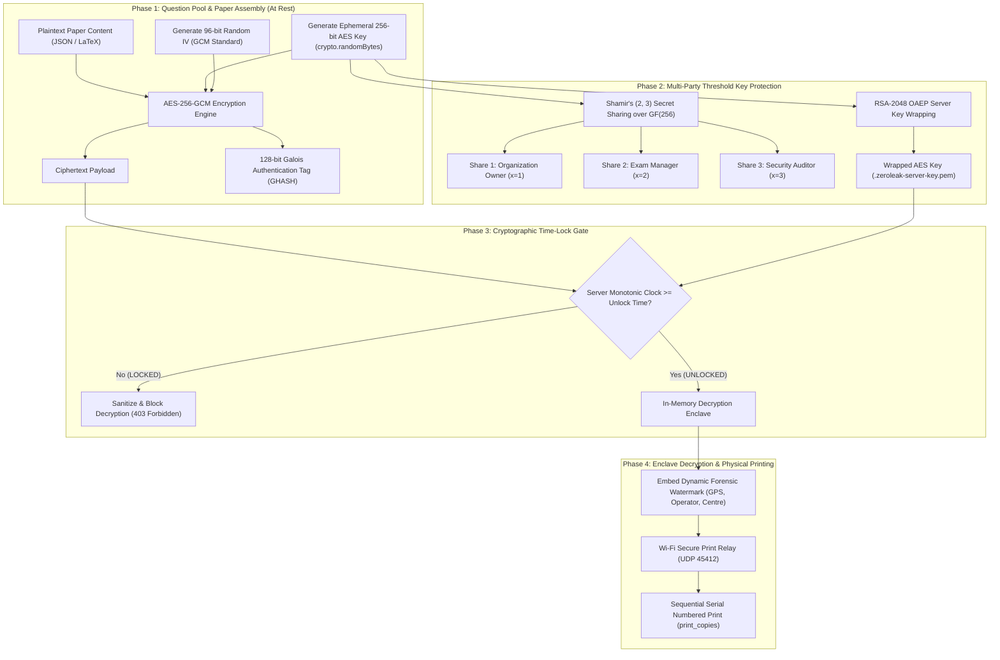

# ZeroLeak: Comprehensive Cybersecurity & Cryptographic Architecture

> **Audit Date:** October 2026 | **Version:** 2.4.0 Production Build  
> **Standards Alignment:** FIPS 140-2 · NIST SP 800-38D (AES-GCM) · NIST SP 800-56B (RSA-OAEP)

---

## 1. High-Level Cryptographic Security Architecture

ZeroLeak is engineered around the principle of **Zero Trust**: no single administrator, developer, or network node is trusted with unencrypted examination assets prior to the authorized examination window.



---

## 2. In-Depth Cryptographic Subsystems

### 2.1 Authenticated Envelope Encryption (`server/crypto.ts`)
- **Symmetric Cipher:** `AES-256-GCM` (Advanced Encryption Standard in Galois/Counter Mode).
- **Key Length:** 256 bits (32 bytes generated via `crypto.randomBytes(32)`).
- **Initialization Vector (IV):** 96 bits (12 bytes generated freshly for every encryption operation). Repeated IVs are mathematically impossible ($P < 2^{-96}$).
- **Integrity & Authenticity:** 128-bit Authentication Tag generated by GHASH over the ciphertext and Associated Data. Any bit-flip or truncation causes decryption to throw an immediate cryptographic exception.
- **Asymmetric Key Wrapping:** The ephemeral AES key is encrypted with the server's public key using `RSA-2048` with `RSA_PKCS1_OAEP_PADDING` and SHA-256 message digest.

### 2.2 Shamir's (2, 3) Secret Sharing over Galois Field GF(256) (`server/thresholdKeyService.ts`)
- **Mathematical Foundation:** Field arithmetic is evaluated over the finite field $GF(2^8)$ constructed using the irreducible polynomial:
  $$P(x) = x^8 + x^4 + x^3 + x + 1 \quad (\text{Hexadecimal: } 0\text{x}11b)$$
  Using generator element $g = 3$.
- **Field Operations:**
  - Addition / Subtraction: Bitwise XOR ($a \oplus b$).
  - Multiplication: Logarithm and exponent lookup tables ($\text{GF\_EXP}[\text{GF\_LOG}[a] + \text{GF\_LOG}[b]]$).
  - Division: Inverted logarithmic subtraction.
- **Threshold Scheme ($k=2, n=3$):**
  For each byte $S_i$ of the 32-byte secret key, a random degree-1 polynomial is sampled:
  $$f_i(x) = S_i \oplus (a_i \cdot x) \quad (\text{over } GF(256))$$
  Where $a_i \in GF(256) \setminus \{0\}$ is a cryptographically random slope.
- **Reconstruction via Lagrange Interpolation:**
  Given any two distinct shares $(x_1, y_1)$ and $(x_2, y_2)$:
  $$S_i = f_i(0) = \left( y_1 \cdot \frac{x_2}{x_1 \oplus x_2} \right) \oplus \left( y_2 \cdot \frac{x_1}{x_1 \oplus x_2} \right)$$
  Knowledge of only one share yields information-theoretic security: all 256 possible key byte values remain equally likely ($H(S \mid \text{Share}_1) = H(S)$).

### 2.3 Zero-Trust Hardware Device Attestation (`server/deviceBinding.ts`)
1. **Device Fingerprinting:** During workstation enrollment, the client generates a hardware-backed cryptographic keypair using the browser's `SubtleCrypto` API (ECDSA P-256 with SHA-256).
2. **Challenge-Response Protocol:**
   - Server generates a cryptographically random 32-byte nonce:
     $$\text{Challenge} = \text{randomBytes}(32)$$
     with a strict 5-minute Time-To-Live (TTL).
   - Client signs the challenge using its private key:
     $$\sigma = \text{Sign}_{K_{\text{private}}}(\text{Challenge})$$
   - Server verifies $\sigma$ using the registered public key stored in `trusted_devices`.
3. **Anti-Tampering Rule:** Even with a valid username, password, and JWT token, access to examination endpoints is rejected if the request does not originate from an approved hardware workstation.

### 2.4 Multi-Layer Forensic Watermarking (`server/synthesizedPaperPdfGenerator.ts`)
Every visual rendering and physical print is permanently fingerprinted with forensic metadata:
- **Operator Legal Name:** E.g., `Manoj Kumar (Centre Superintendent)`.
- **Centre ID & Name:** E.g., `CTR-101 (Apex National Centre)`.
- **Hardware Device UUID:** E.g., `ca4e93eb-7445-45a8-ae7b-728082f20398`.
- **Timestamp:** Exact millisecond ISO-8601 release time.
- **Location:** Exact GPS latitude/longitude (when granted) or resolved timezone enclave region.
- **Serialization:** Sequential serial number stamped into `print_copies` (`CPY-CTR101-00042`).
- **Embedding:** Watermarks are injected as vector drawing commands and semi-transparent diagonal text streams directly into the PDF content stream prior to rendering, preventing removal via PDF layer stripping.

### 2.5 Screen Capture & Display Recording Neutralization (`src/utils/securityProtection.ts`)
To protect displayed examination papers from unauthorized screen capture:
1. **Electron OS Window Protection:** In desktop builds, invokes native Windows/macOS window protection via IPC:
   ```javascript
   mainWindow.setContentProtection(true);
   ```
   This commands the OS Window Compositor (DWM) to render the window completely black in all screen sharing, screenshot tools, and screen recording software.
2. **Web API Neutralization:**
   - Overrides `navigator.mediaDevices.getDisplayMedia` to throw `DOMException('NotAllowedError')`.
   - Overrides `HTMLCanvasElement.prototype.captureStream` and `HTMLMediaElement.prototype.captureStream` to block canvas scraping.
3. **DOM Keyboard Shielding:**
   - Intercepts and suppresses `PrintScreen`, `Ctrl+P` (Print), `Ctrl+S` (Save), `Ctrl+U` (View Source), `F12` (DevTools), and `Ctrl+Shift+I`.
   - Injects global CSS: `user-select: none !important; -webkit-user-select: none !important;`.
   - Applies an active CSS blur filter (`backdrop-blur-3xl`) whenever the window loses focus (`window.onblur`).

