# ZeroLeak: System Architecture & End-to-End Workflows

> **Audit Date:** October 2026 | **Version:** 2.4.0 Production Build  
> **Status:** Verified against application routes in `server.ts` and React workspace components in `src/components/workspaces/`.

---

## 1. High-Level System Architecture Diagram

```mermaid
flowchart TB
    subgraph ClientLayer ["Client Presentation Layer (React 19 + Electron 44 + Tailwind 4)"]
        UI_Owner["Organization Owner Workspace"]
        UI_Manager["Exam Manager Workspace"]
        UI_Trans["Linguistic Translator Studio"]
        UI_Operator["Centre Operator Enclave"]
        UI_Auditor["CBI Security Auditor Workspace"]
        UI_Candidate["Candidate Proctored Portal"]
    end

    subgraph SecurityShield ["Client-Side Security Shield"]
        Guard["GlobalScreenSecurityGuard (DOM Obscuration & Shortcut Block)"]
        WatermarkCanvas["Forensic Dynamic Canvas & Vector Watermark"]
        ElectronProtect["Electron OS Window Protection (setContentProtection)"]
    end

    subgraph APILayer ["Backend API & Gateway Layer (Node.js Express + FastAPI)"]
        AuthMid["authenticateToken & Delegated Authority Validator"]
        DeviceMid["Device Attestation & Challenge Gate (requireAuthorizedDevice)"]
        RoleMid["Role-Based Access Control (requireRole)"]
        Router["Unified Express Router (280+ Endpoints)"]
        FastAPI_WS["FastAPI WebSocket Server (/ws/security-feed)"]
    end

    subgraph ServiceLayer ["Core Business & Cryptographic Services"]
        CryptoService["AES-256-GCM + RSA-2048 Enclave (crypto.ts)"]
        ShamirService["Shamir's (2,3) Secret Sharing over GF(256) (thresholdKeyService.ts)"]
        TimeLock["Cryptographic Time-Lock & Monotonic Clock Gate"]
        PrintRelay["Wi-Fi Secure Print Relay & UDP 45412 Beacon (printStation.ts)"]
        LeakService["Leak Incident Wizard & Zero-Overlap Regen (paperLeakService.ts)"]
        ViewOnce["View-Once Ephemeral Token Burn Service (viewOnceService.ts)"]
    end

    subgraph AISubsystem ["Intelligent Processing & Document Synthesis"]
        AIRouter["Multi-Provider AI Router (Ollama / Groq / Gemini / NVIDIA NIM)"]
        PyMuPDF["PyMuPDF Layout & Visual Bounding Box Slicer"]
        YOLOv8["Ultralytics YOLOv8 Nano Real-Time Proctor (yolov8n.pt)"]
        TectonicEngine["Tectonic Standalone LaTeX Compiler (bin/tectonic.exe)"]
    end

    subgraph StorageLayer ["Persistence & Ledger Layer"]
        SQLiteDB["Primary Engine: SQLite via sql.js (zeroleak_data.sqlite)"]
        PostgresDB["Enterprise Engine: PostgreSQL 14+ (database/schema.sql)"]
        AuditLedger["SHA-256 Chained Immutable Audit Ledger (audit_events)"]
    end

    ClientLayer --> SecurityShield
    SecurityShield --> APILayer
    APILayer --> ServiceLayer
    ServiceLayer <--> AISubsystem
    ServiceLayer <--> StorageLayer
```



---

## 2. Core End-to-End User Workflows

### 2.1 Workflow 1: AI University Paper Generation & Printing Operator Dispatch

```mermaid
sequenceDiagram
    autonumber
    actor EM as Exam Manager
    participant UI as AiExamGeneratorWorkspace
    participant API as Express Server (/api/university/ai-generator)
    participant Py as Python Engine (aiExamGenerator.py)
    participant Tec as Tectonic Compiler (tectonic.exe)
    participant Ledger as Custody Store & SQLite DB
    actor CO as Centre Operator

    EM->>UI: Uploads past question papers (.pdf) & selects University Blueprint
    UI->>API: POST /api/university/ai-generator/upload (Multipart FormData)
    API->>Py: Spawns python process with blueprint configuration
    Py->>Py: Analyzes section layout, choices, and mark allocations
    Py->>Py: Executes multi-pass synthesis (MCQ, Long Theory, Marking Scheme)
    Py->>Tec: Passes generated questions.tex to tectonic.exe
    Tec-->>Py: Compiles vectorized questions.pdf & answers.pdf in ~0.75s
    Py-->>API: Updates status.json with completion telemetry
    API-->>UI: Emits SSE completion event; renders preview in SecurePaperViewer
    
    Note over EM, UI: Raw local PDF downloading is strictly blocked
    EM->>UI: Selects Printing Operator from dropdown (e.g. Dr. Rajesh Patil)
    EM->>UI: Clicks "Send to Printing Operator"
    UI->>API: POST /api/university/ai-generator/send-to-printer (jobId, operatorId, centreId)
    API->>Ledger: Adds job to transferredPrintingJobsServer ledger
    API->>Ledger: Inserts record into SQLite (examinations, paper_versions, examination_centres)
    API-->>UI: Returns queue ID & confirmation banner
    
    CO->>API: Logs in & calls GET /api/delivery/released-exams
    API-->>CO: Returns newly dispatched paper at top of list with status 'READY_FOR_PRINT'
    CO->>UI: Clicks "Open Secure Viewer" -> Views full paper with forensic watermarks
```

#### Detailed Step-by-Step Technical Trace:
1. **User Action:** Examination Manager selects past papers, sets syllabus prompt, and clicks "Generate Examination Paper".
2. **Frontend Component:** [`AiExamGeneratorWorkspace.tsx`](file:///d:/0leakexam-main/src/components/workspaces/AiExamGeneratorWorkspace.tsx) packages files using `FormData` and sends them via `api.uploadAiExam()`.
3. **Backend Route:** Express endpoint `POST /api/university/ai-generator/upload` in [`server/aiExamBridge.ts`](file:///d:/0leakexam-main/server/aiExamBridge.ts) creates an isolated directory in `generated/<jobId>/` and spawns `server/aiExamGenerator.py`.
4. **AI Generation:** `aiExamGenerator.py` extracts text with PyMuPDF, determines structural patterns, constructs prompts, and invokes Ollama or Groq to synthesize syllabus-compliant questions.
5. **Compilation:** `aiExamGenerator.py` invokes `bin/tectonic.exe` to compile `questions.tex` into `questions.pdf` with embedded diagonal watermark text.
6. **Dispatch:** The Examination Manager selects a registered Centre Operator from the dropdown and clicks "Send to Printing Operator".
7. **Custody Handover:** `handleAiExamSendToPrinter` copies `questions.pdf` into `printing_queue/`, registers the record in `(globalThis).transferredPrintingJobsServer`, and inserts metadata into `examinations`, `paper_versions`, and `examination_centres`.
8. **Operator Visibility:** When that Centre Operator logs in, `GET /api/delivery/released-exams` reads the in-memory ledger and database, returning the paper ready for secure enclave viewing and printing.

---

### 2.2 Workflow 2: Cryptographic Time-Lock & Enclave Decryption

```mermaid
sequenceDiagram
    autonumber
    actor CO as Centre Operator
    participant UI as CentreOperatorWorkspace
    participant API as Express Server (/api/delivery)
    participant Clock as Server Monotonic Hardware Clock
    participant Crypto as Crypto Enclave (crypto.ts)
    participant DB as SQLite / PostgreSQL

    CO->>UI: Opens Centre Operator Workspace
    UI->>API: GET /api/delivery/released-exams (Bearer JWT + Device ID)
    API->>Clock: Evaluates serverCurrentTime against exam_date + unlock_time
    alt Current Time < Unlock Time (LOCKED)
        API->>DB: Fetches exam metadata
        API-->>UI: Returns paper metadata with isTimeUnlocked = false (Ciphertext/Keys Redacted)
        UI-->>CO: Displays locked countdown timer; decrypt & print buttons disabled
    else Current Time >= Unlock Time (UNLOCKED)
        API->>DB: Fetches exam metadata & encrypted_papers record
        API-->>UI: Returns isTimeUnlocked = true with status 'READY_FOR_PRINT'
        UI-->>CO: Displays unlocked status; "Open Secure Viewer" enabled
        
        CO->>UI: Clicks "Open Secure Viewer"
        UI->>API: POST /api/delivery/open-viewer (exam_id)
        API->>Crypto: Unwraps RSA-wrapped AES key using server private key
        Crypto->>Crypto: Decrypts AES-256-GCM ciphertext & validates 128-bit Auth Tag
        API-->>UI: Returns decrypted questions array + forensic watermark metadata
        UI-->>CO: Renders paper in SecureViewerModal with dynamic watermark overlay
    end
```

---

### 2.3 Workflow 3: Paper Leak Containment & Zero-Overlap Emergency Regeneration

```mermaid
sequenceDiagram
    autonumber
    actor Auditor as Security Auditor / Manager
    participant UI as PaperLeakManagementView
    participant API as Express Server (/api/papers)
    participant LeakService as paperLeakService.ts
    participant DB as SQLite / PostgreSQL
    actor CO as Centre Operator

    Auditor->>UI: Discovers leaked question photo; enters question IDs into Leak Wizard
    UI->>API: POST /api/papers/leak-incidents (examId, compromisedQuestionIds, severity)
    API->>LeakService: createPaperLeakIncident()
    LeakService->>DB: Updates original paper status to 'COMPROMISED' / 'LOCKED_EMERGENCY'
    LeakService->>DB: Moves leaked question IDs into question_quarantines table
    LeakService->>DB: Emits CRITICAL event to audit_events ledger
    
    Auditor->>UI: Clicks "Emergency Regenerate Replacement Paper"
    UI->>API: POST /api/papers/emergency-regenerate (incidentId, excludeQuestionIds)
    API->>LeakService: regenerateReplacementPaperWithZeroOverlap()
    LeakService->>DB: Queries question pool filtering out ALL quarantined IDs
    Note over LeakService: Mathematical guarantee: 0% overlap with leaked questions
    LeakService->>LeakService: Synthesizes replacement questions & compiles Set-E replacement
    LeakService->>API: Encrypts replacement paper with fresh AES-256-GCM key
    LeakService->>DB: Inserts replacement paper into emergency_papers table
    
    CO->>API: Calls GET /api/delivery/released-exams
    API-->>CO: Original compromised paper is revoked; replacement Set-E paper is served
```

